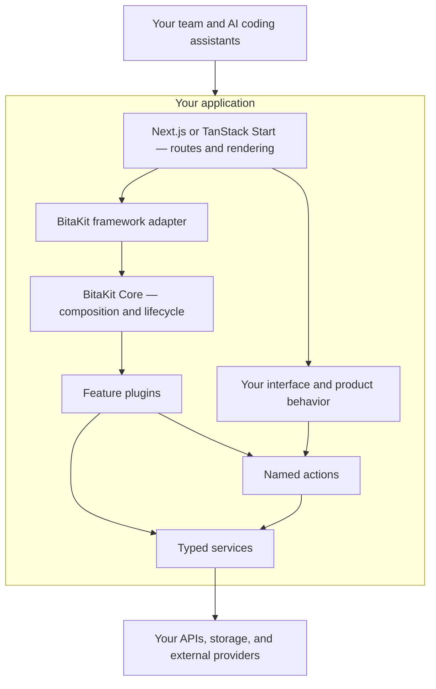

<p align="center">
  
</p>

<h1 align="center">Your next app. Your building blocks. Your rules.</h1>

<p align="center">
  An AI-friendly composition layer for your application.<br>
  Keep your framework. Structure your features. Build with confidence.
</p>

<p align="center">
  <a href="packages/core/README.md">Start with Core</a> ·
  <a href="packages/core/docs/todo-tutorial.md">Build a To-do plugin</a> ·
  <a href="packages/README.md">Explore packages</a> ·
  <a href="docs/TODO.md">Roadmap</a>
</p>

> **Early preview.** Core is available on npm. The generator and remaining packages
> are being prepared for publication. APIs are still evolving; TanStack Start is experimental.

## Build the product you have in mind

Keep building with **Next.js** or **TanStack Start**. BitaKit adds a shared structure
for your application's features: plugins group capabilities, services expose behavior,
and actions connect that behavior to your interface.

**Your framework builds the app. BitaKit helps its features work together.**
It complements your framework rather than replacing it: native routes, rendering,
and deployment stay with your chosen stack. TanStack Start integration is currently
experimental.

**AI-friendly. Human-readable.** Give your team and coding assistants a common map:
where features belong, how services connect, and how actions are exposed. Explicit
contracts and predictable conventions provide context for AI-assisted development
and make the resulting code easier for people to navigate and review. Tests and
review remain part of the workflow.

**Modular by design.** Begin with Core and add the packages your product needs.
Keep a feature's behavior together in a plugin, then compose it with the rest of
your application.

**Type-safe feature composition.** Carry service method inputs and results, action
inputs and completed results, known event payloads and configuration types from their
definitions to callers. Discovery generates the application contracts for editor
completion and compile-time checks. Optional strict Action IDs catch unknown names;
runtime schemas and server authorization protect external boundaries. See the
[Core type-safety guide](apps/docs/content/docs/concepts/type-safety.mdx).

**Your app stays yours.** Keep your native framework routes, choose your visual
components, and connect your own services through public contracts. The headless
Core runs without React or a browser; optional integrations connect it to your host.

**Less wiring. More building.** In a configured host, discovery connects supported
plugin, service, and action files and generates their registration and types.
Define your feature in the expected structure and let the build handle the wiring.
[See how discovery works](docs/concepts/discovery.md).

**Room to grow.** Add features through plugins and extend the application through
shared contracts. Build a focused internal tool, an admin application, or the
foundation of a SaaS product—without making SaaS a requirement.



The adapter connects BitaKit to the host framework. Core coordinates trusted plugins
and their lifecycle; it does not take over routing, rendering, or deployment.
The diagram describes responsibilities, not automatic persistence or generated business logic.

| Build with                      | Responsibility                                                      |
| ------------------------------- | ------------------------------------------------------------------- |
| **Core**                        | Plugins, services, actions, configuration, and lifecycle.           |
| **React bindings**              | Connect your interface to the shared runtime.                       |
| **Next.js / TanStack adapters** | Connect discovery and navigation to your framework.                 |
| **Optional plugins**            | Add settings, shell, search, translation, or provider integrations. |

Third-party plugins can live in their own repositories. They connect through public
contracts; they do not need to become part of this monorepo.

## Build your first feature

Create an app, add a To-do plugin, and bind an action to your interface.

### 1. Create your app

> **Release preview:** The app generator and framework packages are not published
> yet. The command below shows the intended setup after release. Core is already
> available on npm.

```sh
npx @bitakit/create-app my-app
```

Choose **Next.js** or **TanStack Start** (experimental). This walkthrough uses Next.js.
The generator connects the BitaKit provider and build-time discovery.

```sh
cd my-app
npm run dev
```

Your pages and routes remain ordinary Next.js files.

### 2. Add a plugin folder

Create the `todos` feature files under `src/plugins`. The generator creates the app;
for this example, you add these plugin files yourself.

```text
src/
├── app/
│   ├── layout.tsx
│   └── page.tsx
└── plugins/
    └── todos/
        ├── services/
        │   └── tasks.ts
        └── actions/
            └── create.ts
```

A **service** owns the task behavior. An **action** exposes an operation to your UI.
The plugin folder groups them into one feature.

### 3. Define the service

`src/plugins/todos/services/tasks.ts`

```ts
import { defineService } from '@bitakit/core';

export default defineService({
  create() {
    const tasks: string[] = [];

    return {
      add(title: string) {
        tasks.push(title);
      },

      list() {
        return [...tasks];
      },
    };
  },
});
```

Core creates the service when the plugin starts. This example keeps tasks in memory;
a page reload clears them. A service does not automatically provide database persistence.

### 4. Define the action

`src/plugins/todos/actions/create.ts`

```ts
import { defineAction } from '@bitakit/core';

export default defineAction<string>({
  requires: ['tasks'],

  execute({ services, input }) {
    services.tasks.add(input);
  },
});
```

The action receives a task title and passes it to the service.

### 5. Let discovery connect the feature

In the generated app, discovery finds supported files and generates their imports,
registration, and types during the build.

| Contribution         | Discovered identity    |
| -------------------- | ---------------------- |
| `src/plugins/todos/` | Plugin `todos`         |
| `services/tasks.ts`  | Public service `tasks` |
| `actions/create.ts`  | Action `todos.create`  |

No handwritten list of service or action imports is needed. You write the feature's
behavior; the configured discovery integration connects it. See
[how discovery works](docs/concepts/discovery.md) for conventions and boundaries.

### 6. Bind the action to your UI

`src/app/page.tsx`

```tsx
'use client';

import { ActionButton } from '@bitakit/ui';

export default function Page() {
  return (
    <main>
      <h1>My tasks</h1>

      <ActionButton action="todos.create" input="New task">
        Add a task
      </ActionButton>
    </main>
  );
}
```

Each click adds **New task** through the action. There is no manual click handler:
`ActionButton` binds execution and the action's current state to the button. It is
disabled when the action is disabled or pending, and hidden when the action is hidden.
Use its `as` prop to render your application's existing button component.

This first step demonstrates the connection, not a complete task-list screen: tasks
are stored but not displayed yet. List rendering, input fields, and a disabled delete
action are natural next steps. Discovery does not automatically make service data reactive.

**Your framework renders the page. Your plugin defines the feature. BitaKit connects the parts.**

For a standalone, framework-free example with explicit registration and three actions,
see the [To-do tutorial](packages/core/docs/todo-tutorial.md).

## Learn the ideas behind the building blocks

- **[How does discovery work?](docs/concepts/discovery.md)** Connect supported contributions through file conventions and generated registration.
- **[Why actions?](docs/concepts/actions.md)** One operation, shared across buttons, menus, and other entry points.
- **[What is a service?](docs/concepts/services.md)** Reusable behavior, explicit contracts, and managed lifetimes.
- **[Configuration or user preferences?](docs/concepts/configuration-and-preferences.md)** Understand what Core owns and what optional settings packages add.
- **[Build a To-do plugin](packages/core/docs/todo-tutorial.md)** Follow one feature from definition to execution.

## Explore the documentation

Requirements: **Node.js 24** and **npm 10 or newer**.

```sh
git clone https://github.com/mvavesal/bitakit.git
cd bitakit
npm ci
npm run dev:docs
```

Open [localhost:3002/docs](http://localhost:3002/docs) for searchable guides.
The repository is currently private, so cloning requires access. The documentation
site is a separate Fumadocs application and does not require a database.

To generate an application before npm publication, follow the generator's
[local package workflow](packages/create-app/README.md#verify-before-publication).
The [quick start](apps/docs/content/docs/quickstart.mdx) presents the intended
application-developer experience.

## Repository map

| Directory                            | Purpose                                                        |
| ------------------------------------ | -------------------------------------------------------------- |
| `packages/core`                      | Framework-independent runtime, Actions and Node-only discovery |
| `packages/ui`                        | React bindings and optional standard components                |
| `packages/next`, `packages/tanstack` | Optional framework integrations                                |
| `packages/create-app`                | Frontend generator                                             |
| Other `packages/*`                   | Optional capabilities and provider integrations                |
| `apps/docs`                          | Developer documentation                                        |
| `docs`                               | Architecture notes and roadmap                                 |
| `scripts`                            | Workspace and verification tools                               |

See the [package guide](packages/README.md) for individual responsibilities.

## Current boundaries

- TanStack Start support is **experimental**; see its [verified scope](packages/tanstack/README.md).
- The Next.js generator uses Webpack while the tracked Turbopack discovery issue is open.
- Plugin discovery is not a marketplace, remote installer or sandbox for untrusted code.
- Core is published; the remaining package releases and hosted documentation are pending.

## Contributing and licensing

Keep changes focused, preserve the package boundaries, and document public behavior
in English. Start with the [contributor guide](apps/docs/content/docs/contributing.mdx)
and the nearest `AGENTS.md` before changing a package or application.

BitaKit is licensed under the [MIT License](LICENSE). Third-party components retain
their own licenses; see [THIRD_PARTY_NOTICES.md](THIRD_PARTY_NOTICES.md).
