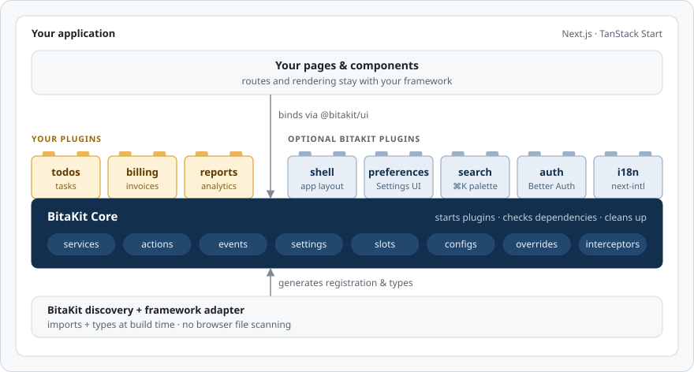
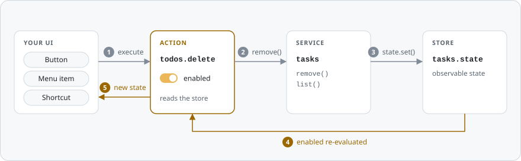

<p align="center">
  
</p>

<h1 align="center">Build your app bit by bit.</h1>

<p align="center">
  <b>Plug in features. Pair with AI. Ship with confidence.</b><br>
  BitaKit is the AI-friendly composition layer for Next.js and TanStack Start.<br>
  Break your product into clean plugins and grow it one building block at a time.
</p>

<p align="center">
  <a href="https://www.npmjs.com/package/@bitakit/core"></a>
  <a href="LICENSE"></a>
  
  
  
</p>

<p align="center">
  <a href="#-from-zero-to-running-app-in-one-command">Quick start</a> ·
  <a href="#-ship-features-with-your-ai-assistant">AI workflow</a> ·
  <a href="#-break-your-app-into-plugins">Plugins</a> ·
  <a href="packages/core/README.md">Core</a> ·
  <a href="packages/README.md">Packages</a> ·
  <a href="docs/TODO.md">Roadmap</a>
</p>

> [!NOTE]
> **Early release.** All 14 BitaKit packages and the app generator are on npm.
> APIs are still evolving, and TanStack Start support is experimental.

## ⚡ From zero to running app in one command

```sh
npx @bitakit/create-app my-app
```

Pick **Next.js** or **TanStack Start**, tick the extras you want — app shell, settings,
⌘K quick search — and start building. Your pages stay plain framework routes.
No lock-in, no magic folder you can't leave.

## Why BitaKit?

Every app starts clean. Then the features pile up. Imports tangle, every new button
needs wiring in five places, and both your new teammate and your AI assistant get lost
in the sprawl.

**BitaKit gives every feature a home.** A plugin groups it, services hold its behavior,
actions expose it to your UI, events keep everything in sync, and configs give it
defaults your app can override. Same shape, every time.

<table>
  <tr>
    <td width="50%" valign="top">
      <h3>🤖 Pair with AI, minus the chaos</h3>
      Predictable folders and typed contracts give your coding assistant precise context:
      where a feature lives, what it needs, and what it exposes. Ask for a change,
      get a small, focused diff you can actually review.
    </td>
    <td width="50%" valign="top">
      <h3>🧩 Your app, in plugins</h3>
      Split your product into self-contained plugins that own their services, actions
      and events. Teams — and agents — work side by side without stepping on each other.
    </td>
  </tr>
  <tr>
    <td width="50%" valign="top">
      <h3>🧱 Grow bit by bit</h3>
      Start with headless Core. Add an app shell, settings, search, authentication,
      organizations, translations or email when your product needs them — not before.
    </td>
    <td width="50%" valign="top">
      <h3>🔌 Less wiring, more building</h3>
      Drop a file into the right folder. Build-time discovery generates the imports,
      registration and types. No hand-kept registries. No provider soup.
    </td>
  </tr>
  <tr>
    <td width="50%" valign="top">
      <h3>🛡️ Type-safe from definition to button</h3>
      Service methods, action inputs and results, and event payloads carry their types
      all the way to the call site. Optional strict mode catches unknown action IDs.
    </td>
    <td width="50%" valign="top">
      <h3>🏠 Your stack stays yours</h3>
      Keep your routes, components, design system and backend. BitaKit composes your
      features; it never takes over routing, rendering or deployment.
    </td>
  </tr>
</table>

## 🤖 Ship features with your AI assistant

BitaKit's conventions double as a map for AI. Every feature has the same shape, so an
assistant knows exactly where new code belongs — and you know exactly what to review.

> **You:** Add a delete action to the todos plugin. Disable it while the list is empty.

```text
src/plugins/todos/
├── services/
│   └── tasks.ts      ✏️  adds remove() and emits "todos.changed"
└── actions/
    ├── create.ts
    └── delete.ts     ✨  new — discovered as todos.delete
```

```ts
// src/plugins/todos/actions/delete.ts
import { defineAction } from '@bitakit/core';

export default defineAction<string>({
  // Services this action uses. Core checks that they exist before registering it.
  requires: ['tasks'],

  // Initial state: the task list starts empty, so deleting is disabled.
  enabled: false,

  // Events this action reacts to.
  events: ['todos.changed'],

  // Runs each time one of those events is emitted. Core owns the subscription.
  onEvent(_event, { services, action }) {
    action.enabled = services.tasks.list().length > 0;
  },

  // Runs when a bound control or your code executes the action.
  execute: ({ services, input }) => services.tasks.remove(input),
});
```

<details>
<summary><b>The matching service change</b> — one new method, two <code>emit</code> calls</summary>

```diff
 import { defineService } from '@bitakit/core';

 export default defineService({
-  create() {
-    const tasks: string[] = [];
+  create({ events }) {
+    let tasks: string[] = [];

     return {
       add(title: string) {
         tasks.push(title);
+        events.emit('todos.changed');
       },

+      remove(title: string) {
+        tasks = tasks.filter((task) => task !== title);
+        events.emit('todos.changed');
+      },
+
       list() {
         return [...tasks];
       },
```

</details>

No registry to update. No provider to touch. No subscription to clean up.
**The diff is as small as the idea.** Every button bound to `todos.delete` disables
itself while the list is empty — without a single extra line of UI code.

> [!TIP]
> Reacting to events needs no `setup` method. Add `setup` only when the initial
> state must be read from existing data, such as tasks loaded from storage.

The same clarity helps human reviewers: one feature, one folder, explicit dependencies.
Tests and review stay part of your workflow; BitaKit just makes them easier to focus.

## 🧩 Break your app into plugins

A plugin is a feature in a folder. Write your own, install ready-made ones, and snap
them onto Core — it starts them, checks their dependencies and cleans them up.

<p align="center">
  <picture>
    <source media="(prefers-color-scheme: dark)" srcset="docs/assets/readme/architecture-dark.svg">
    
  </picture>
</p>

Your framework keeps routes and rendering. Plugins share behavior through typed
services, actions and events instead of reaching into each other's internals.

**Install a plugin, get a feature.** In a Shell app, `npm install @bitakit/quick-search`
adds a ⌘K search for your app's navigation to the app bar — no provider, no registry,
no glue code.

**Share plugins like packages.** Plugins can live in your app or in their own
repositories. Published plugins connect through the same public contracts.

## 🧱 Grow at your own pace

Start small. Add capabilities one building block at a time. Every package except Core
is optional.

| When you need…            | Add                                                                           | You get                                                                        |
| ------------------------- | ----------------------------------------------------------------------------- | ------------------------------------------------------------------------------ |
| A clean feature structure | `@bitakit/core`                                                               | Plugins, services, actions, events, configs and interceptors — Node or browser |
| React and your framework  | `@bitakit/ui` · `@bitakit/next` or `@bitakit/tanstack`                        | `ActionButton`, hooks, build-time discovery and typed IDs                      |
| An application frame      | `@bitakit/shell` · `@bitakit/app-preferences`                                 | Layout, navigation, settings pages and saved preferences                       |
| Fast navigation           | `@bitakit/quick-search`                                                       | ⌘K search across your app's navigation                                         |
| Users and teams           | `@bitakit/better-auth` · `@bitakit/better-auth-ui` · `@bitakit/organizations` | Authentication, account screens and organizations                              |
| More languages            | `@bitakit/next-intl`                                                          | Translations and a language preference                                         |
| Email                     | `@bitakit/email` · `@bitakit/nodemailer`                                      | A provider-independent sending contract with SMTP delivery                     |

## 🚀 Build your first feature

Create an app, add a To-do plugin, and bind an action to your interface.

### 1. Create your app

```sh
npx @bitakit/create-app my-app
cd my-app
npm run dev
```

This walkthrough uses Next.js. The generator connects the BitaKit provider and
build-time discovery; your pages and routes remain ordinary Next.js files.

### 2. Add a plugin folder

```text
src/
├── app/
│   ├── layout.tsx
│   └── page.tsx
└── plugins/
    └── todos/
        ├── services/
        │   └── tasks.ts
        └── actions/
            └── create.ts
```

A **service** owns the task behavior. An **action** exposes an operation to your UI.
The plugin folder groups them into one feature.

### 3. Define the service

`src/plugins/todos/services/tasks.ts`

```ts
import { defineService } from '@bitakit/core';

export default defineService({
  create() {
    const tasks: string[] = [];

    return {
      add(title: string) {
        tasks.push(title);
      },

      list() {
        return [...tasks];
      },
    };
  },
});
```

Core creates the service when the plugin starts. This example keeps tasks in memory,
so a page reload clears them.

### 4. Define the action

`src/plugins/todos/actions/create.ts`

```ts
import { defineAction } from '@bitakit/core';

export default defineAction<string>({
  // Services this action uses. Core checks that they exist before registering it.
  requires: ['tasks'],

  // Runs when a bound control or your code executes the action.
  execute({ services, input }) {
    services.tasks.add(input);
  },
});
```

### 5. Let discovery connect the feature

Discovery finds supported files and generates their imports, registration and types
during the build:

| Contribution         | Discovered identity    |
| -------------------- | ---------------------- |
| `src/plugins/todos/` | Plugin `todos`         |
| `services/tasks.ts`  | Public service `tasks` |
| `actions/create.ts`  | Action `todos.create`  |

No handwritten import list. See [how discovery works](docs/concepts/discovery.md).

### 6. Bind the action to your UI

`src/app/page.tsx`

```tsx
'use client';

import { ActionButton } from '@bitakit/ui';

export default function Page() {
  return (
    <main>
      <h1>My tasks</h1>

      <ActionButton action="todos.create" input="New task">
        Add a task
      </ActionButton>
    </main>
  );
}
```

Each click adds **New task** through the action — no click handler required.
`ActionButton` follows the action's state: disabled while it is disabled or pending,
hidden while it is hidden. Use its `as` prop to render your own button component.

Tasks are stored but not displayed yet; list rendering and input fields are natural
next steps. For a framework-free version with three actions, follow the
[To-do tutorial](packages/core/docs/todo-tutorial.md).

**Your framework renders the page. Your plugin defines the feature. BitaKit connects the parts.**

## 🔍 Under the hood

One action, every entry point. Here is the `todos.delete` action from above at runtime:

<p align="center">
  <picture>
    <source media="(prefers-color-scheme: dark)" srcset="docs/assets/readme/action-loop-dark.svg">
    
  </picture>
</p>

The service owns the data, the event announces the change, and the action decides
what that means for its controls. Core delivers the event and keeps every binding in
sync. It runs in Node and the browser without React, and it never persists data for
you: storage stays your choice.

## 📚 Learn the ideas

- **[How does discovery work?](docs/concepts/discovery.md)** File conventions in, registration and types out.
- **[Why actions?](docs/concepts/actions.md)** One operation, shared by buttons, menus and links.
- **[What is a service?](docs/concepts/services.md)** Reusable behavior, explicit contracts, managed lifetimes.
- **[Configuration or user preferences?](docs/concepts/configuration-and-preferences.md)** What Core owns and what settings packages add.
- **[Type safety](apps/docs/content/docs/concepts/type-safety.mdx)** How types travel from definitions to callers.
- **[Build a To-do plugin](packages/core/docs/todo-tutorial.md)** Follow one feature from definition to execution.

## 🧭 Honest boundaries

- TanStack Start support is **experimental**; see its [verified scope](packages/tanstack/README.md).
- The Next.js generator uses Webpack while the tracked Turbopack discovery issue is open.
- Plugins are trusted application code. Discovery is not a marketplace, remote installer or sandbox.
- Services don't persist data or make it reactive on their own — you choose storage and subscriptions.
- TypeScript checks your code; validate external input and authorize requests on the server.

## Explore the documentation locally

Requirements: **Node.js 24** and **npm 10 or newer**.

```sh
git clone https://github.com/mvavesal/bitakit.git
cd bitakit
npm ci
npm run dev:docs
```

Open [localhost:3002/docs](http://localhost:3002/docs) for searchable guides. The
repository is currently private, so cloning requires access. Hosted documentation
is being prepared.

<details>
<summary><b>Repository map</b></summary>

| Directory                            | Purpose                                                        |
| ------------------------------------ | -------------------------------------------------------------- |
| `packages/core`                      | Framework-independent runtime, Actions and Node-only discovery |
| `packages/ui`                        | React bindings and optional standard components                |
| `packages/next`, `packages/tanstack` | Optional framework integrations                                |
| `packages/create-app`                | Frontend generator                                             |
| Other `packages/*`                   | Optional capabilities and provider integrations                |
| `apps/docs`                          | Developer documentation                                        |
| `docs`                               | Architecture notes and roadmap                                 |
| `scripts`                            | Workspace and verification tools                               |

See the [package guide](packages/README.md) for individual responsibilities.

</details>

## Contributing and licensing

Keep changes focused, preserve the package boundaries, and document public behavior
in English. Start with the [contributor guide](apps/docs/content/docs/contributing.mdx)
and the nearest `AGENTS.md` — it guides human contributors and coding assistants alike.

BitaKit is licensed under the [MIT License](LICENSE). Third-party components retain
their own licenses; see [THIRD_PARTY_NOTICES.md](THIRD_PARTY_NOTICES.md).

<p align="center">
  <b>Your app. Your building blocks. Built bit by bit.</b>
</p>
