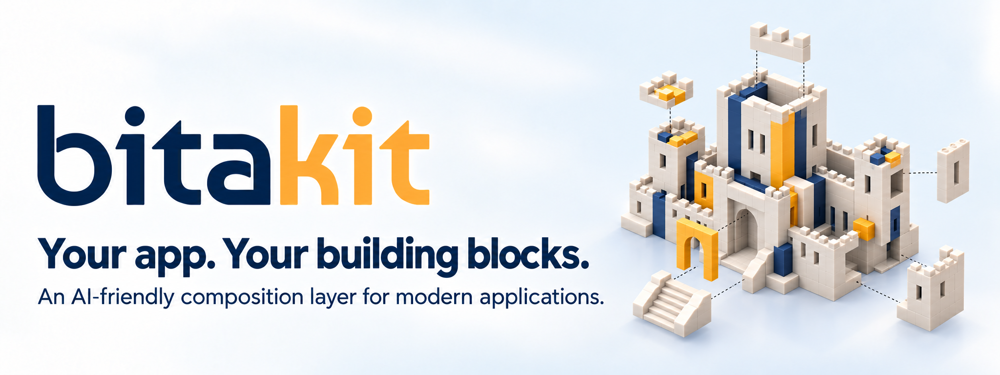
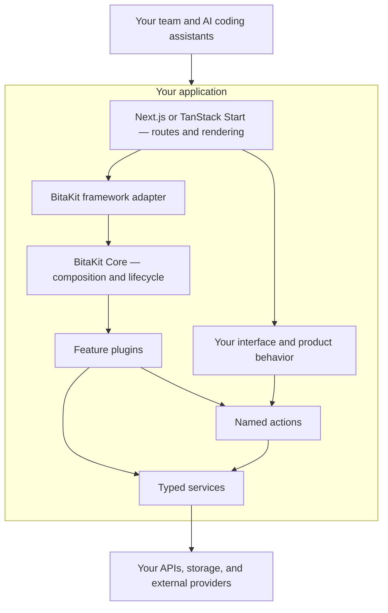

<p align="center">
  
</p>

<h1 align="center">Your next app. Your building blocks. Your rules.</h1>

<p align="center">
  An AI-friendly composition layer for your application.<br>
  Keep your framework. Structure your features. Build with confidence.
</p>

<p align="center">
  <a href="packages/core/README.md">Start with Core</a> ·
  <a href="packages/core/docs/todo-tutorial.md">Build a To-do plugin</a> ·
  <a href="packages/README.md">Explore packages</a> ·
  <a href="docs/TODO.md">Roadmap</a>
</p>

> **Early preview.** Core is available on npm. The generator and remaining packages
> are being prepared for publication. APIs are still evolving; TanStack Start is experimental.

## Build the product you have in mind

Keep building with **Next.js** or **TanStack Start**. BitaKit adds a shared structure
for your application's features: plugins group capabilities, services expose behavior,
and actions connect that behavior to your interface.

**Your framework builds the app. BitaKit helps its features work together.**
It complements your framework rather than replacing it: native routes, rendering,
and deployment stay with your chosen stack. TanStack Start integration is currently
experimental.

**AI-friendly. Human-readable.** Give your team and coding assistants a common map:
where features belong, how services connect, and how actions are exposed. Explicit
contracts and predictable conventions provide context for AI-assisted development
and make the resulting code easier for people to navigate and review. Tests and
review remain part of the workflow.

**Modular by design.** Begin with Core and add the packages your product needs.
Keep a feature's behavior together in a plugin, then compose it with the rest of
your application.

**Typed where the pieces connect.** Typed service contracts and action definitions
help you carry inputs and results across feature boundaries. Discovery can generate
registration and application types from your contributions. Runtime validation and
server authorization still belong at the appropriate application boundaries.

**Your app stays yours.** Keep your native framework routes, choose your visual
components, and connect your own services through public contracts. The headless
Core runs without React or a browser; optional integrations connect it to your host.

**Less wiring. More building.** In a configured host, discovery connects supported
plugin, service, and action files and generates their registration and types.
Define your feature in the expected structure and let the build handle the wiring.
[See how discovery works](docs/concepts/discovery.md).

**Room to grow.** Add features through plugins and extend the application through
shared contracts. Build a focused internal tool, an admin application, or the
foundation of a SaaS product—without making SaaS a requirement.



The adapter connects BitaKit to the host framework. Core coordinates trusted plugins
and their lifecycle; it does not take over routing, rendering, or deployment.
The diagram describes responsibilities, not automatic persistence or generated business logic.

| Build with                      | Responsibility                                                      |
| ------------------------------- | ------------------------------------------------------------------- |
| **Core**                        | Plugins, services, actions, configuration, and lifecycle.           |
| **React bindings**              | Connect your interface to the shared runtime.                       |
| **Next.js / TanStack adapters** | Connect discovery and navigation to your framework.                 |
| **Optional plugins**            | Add settings, shell, search, translation, or provider integrations. |

Third-party plugins can live in their own repositories. They connect through public
contracts; they do not need to become part of this monorepo.

## Start small: a To-do plugin

A **service** keeps the tasks. An **action** adds a task. A **plugin** groups them.
Core starts the feature and manages its registrations and cleanup.

The following plain JavaScript example runs without a UI framework. Each file has
one role, so you can see how a feature fits together.

```text
todos.mjs             Run the feature
todos/
├── plugin.mjs         Compose the service and actions
├── services/
│   └── tasks.mjs      Own task operations and state
└── actions/
    ├── create.mjs     Create a task
    ├── list.mjs       List tasks
    └── delete.mjs     Delete a task
```

```sh
npm install @bitakit/core
```

### 1. Give the feature a service

The service owns the task collection. This example stores tasks in memory; it does not persist them to a database.

`todos/services/tasks.mjs`

```js
import { defineService } from '@bitakit/core';

function createTodoService() {
  let tasks = [];
  let nextId = 1;

  function create(title) {
    const task = { id: nextId++, title, done: false };
    tasks.push(task);
    return task;
  }

  return {
    create,
    list: () => [...tasks],
    delete(id) {
      const previousCount = tasks.length;
      tasks = tasks.filter((task) => task.id !== id);
      return tasks.length < previousCount;
    },
  };
}

export default defineService({
  id: 'todos',
  create: createTodoService,
});
```

### 2. Expose operations as actions

The create action declares its required service and forwards the input to it.

`todos/actions/create.mjs`

```js
import { defineAction } from '@bitakit/core';

export default defineAction({
  id: 'todos.create',
  requires: ['todos'],
  execute: ({ services, input }) => services.todos.create(input),
});
```

The other two actions use the same service:

`todos/actions/list.mjs`

```js
import { defineAction } from '@bitakit/core';

export default defineAction({
  id: 'todos.list',
  requires: ['todos'],
  execute: ({ services }) => services.todos.list(),
});
```

`todos/actions/delete.mjs`

```js
import { defineAction } from '@bitakit/core';

export default defineAction({
  id: 'todos.delete',
  requires: ['todos'],
  execute: ({ services, input }) => services.todos.delete(input),
});
```

### 3. Group the feature in a plugin

The plugin brings these definitions together. Core manages their registration and lifetime.

`todos/plugin.mjs`

```js
import { definePlugin } from '@bitakit/core';
import tasks from './services/tasks.mjs';
import create from './actions/create.mjs';
import list from './actions/list.mjs';
import remove from './actions/delete.mjs';

export default definePlugin({
  id: 'todos',
  services: [tasks],
  actions: [create, list, remove],
});
```

### 4. Start it and use it

Mount the runtime, execute the actions, and release the registrations when finished.

`todos.mjs`

```js
import { createActionList, FoundationRuntime } from '@bitakit/core';
import todos from './todos/plugin.mjs';

const actions = createActionList();
const runtime = new FoundationRuntime(actions, { plugins: [todos] });
const stop = runtime.mount();

try {
  await actions.execute('todos.create', 'Learn plugins');
  await actions.execute('todos.create', 'Connect a service');
  await actions.execute('todos.create', 'Try actions');
  console.log('Before:', await actions.execute('todos.list'));
  await actions.execute('todos.delete', 2);
  console.log('After:', await actions.execute('todos.list'));
} finally {
  stop();
}
```

The first list contains three tasks. After deleting task 2, the second contains
tasks 1 and 3. Action execution returns an outcome with `status` and `value`.

This example uses explicit registration to make the connections visible. In a
[discovery-enabled host](docs/concepts/discovery.md), supported file conventions
generate registration instead. The operations themselves remain your feature code.

Follow **[Build your first To-do plugin](packages/core/docs/todo-tutorial.md)**
for setup, expected output, and where UI and persistence fit.

Want to understand the runtime first? Read the **[Core introduction](packages/core/README.md)**.

## Learn the ideas behind the building blocks

- **[How does discovery work?](docs/concepts/discovery.md)** Connect supported contributions through file conventions and generated registration.
- **[Why actions?](docs/concepts/actions.md)** One operation, shared across buttons, menus, and other entry points.
- **[What is a service?](docs/concepts/services.md)** Reusable behavior, explicit contracts, and managed lifetimes.
- **[Configuration or user preferences?](docs/concepts/configuration-and-preferences.md)** Understand what Core owns and what optional settings packages add.
- **[Build a To-do plugin](packages/core/docs/todo-tutorial.md)** Follow one feature from definition to execution.

## Explore the documentation

Requirements: **Node.js 24** and **npm 10 or newer**.

```sh
git clone https://github.com/mvavesal/bitakit.git
cd bitakit
npm ci
npm run dev:docs
```

Open [localhost:3002/docs](http://localhost:3002/docs) for searchable guides.
The repository is currently private, so cloning requires access. The documentation
site is a separate Fumadocs application and does not require a database.

To generate an application before npm publication, follow the generator's
[local package workflow](packages/create-app/README.md#verify-before-publication).
The [quick start](apps/docs/content/docs/quickstart.mdx) presents the intended
application-developer experience.

## Repository map

| Directory                            | Purpose                                                            |
| ------------------------------------ | ------------------------------------------------------------------ |
| `packages/core`                      | Framework-independent runtime, Actions and Node-only discovery     |
| `packages/ui`                        | React bindings and optional standard components                    |
| `packages/next`, `packages/tanstack` | Optional framework integrations                                    |
| `packages/create-app`                | Frontend generator                                                 |
| Other `packages/*`                   | Optional capabilities and provider integrations                    |
| `apps/docs`                          | Developer documentation                                            |
| `docs`                               | Architecture notes and roadmap                                     |
| `scripts`                            | Workspace and verification tools                                   |

See the [package guide](packages/README.md) for individual responsibilities.

## Current boundaries

- TanStack Start support is **experimental**; see its [verified scope](packages/tanstack/README.md).
- The Next.js generator uses Webpack while the tracked Turbopack discovery issue is open.
- Plugin discovery is not a marketplace, remote installer or sandbox for untrusted code.
- Core is published; the remaining package releases and hosted documentation are pending.

## Contributing and licensing

Keep changes focused, preserve the package boundaries, and document public behavior
in English. Start with the [contributor guide](apps/docs/content/docs/contributing.mdx)
and the nearest `AGENTS.md` before changing a package or application.

BitaKit is licensed under the [MIT License](LICENSE). Third-party components retain
their own licenses; see [THIRD_PARTY_NOTICES.md](THIRD_PARTY_NOTICES.md).
