<p align="center">
  
</p>

# BitaKit

[Website](https://bitakit.app/) · [Documentation](https://mvavesal.github.io/bitakit/docs/)

**BitaKit is an AI-friendly composition layer for building extensible apps—designed for
developers and AI agents to work together.** Every feature is a self-contained plugin in its
own folder, connected through explicit contracts. Developers and AI agents can add and extend
features through small, local changes, using BitaKit's shared commands, events, extension points
and settings.

BitaKit is not another framework. It sits on top of the one you already use, through an adapter
(Next.js today, TanStack Start experimental), which keeps routing, rendering and deployment.

<picture>
  <source media="(prefers-color-scheme: dark)" srcset="docs/assets/readme/layers-dark.svg">
  
</picture>

## Quick start

You need Node.js 24 and npm 10 or newer, pnpm, Yarn or Bun.

**1. Create an app** (Next.js with navigation, settings and search included):

```bash
npx @bitakit/create-app my-app --yes
```

With pnpm, Yarn or Bun, start it with `pnpm create @bitakit/app my-app --yes`,
`yarn create @bitakit/app my-app --yes` or `bunx @bitakit/create-app@latest my-app --yes`; the
app then installs and runs with that package manager.

**2. Run it:**

```bash
cd my-app && npm run dev
```

Open [localhost:3000](http://localhost:3000). There is no configuration to edit.

**3. Add your first feature.** A folder under `src/plugins/` is a feature; each file's path is
its ID. Three small files give a page, shared state and an Action:

```text
src/plugins/counter/
├── services/value.ts     → services.counter.value
├── actions/increment.ts  → action "counter.increment"
└── ui/pages/index.tsx    → page /counter
```

```ts
// src/plugins/counter/services/value.ts
import { defineService } from '@bitakit/core';

export default defineService(({ store }) => {
  const state = store({ count: 0 });
  return {
    state,
    increment: () => state.set((s) => ({ count: s.count + 1 })),
  };
});
```

```ts
// src/plugins/counter/actions/increment.ts
import { defineAction } from '@bitakit/core';

export default defineAction({
  title: 'Increment',
  execute: ({ services }) => services.counter.value.increment(),
});
```

```tsx
// src/plugins/counter/ui/pages/index.tsx
'use client';
import { Action, useServiceState } from '@bitakit/ui';
import { Button, PageHeader } from '@bitakit/ui/components';

export default function CounterPage() {
  const count = useServiceState('counter.value', (state) => state.count, 0);
  return (
    <>
      <PageHeader title="Counter" />
      <output>{count}</output>
      <Action id="counter.increment">
        <Button />
      </Action>
    </>
  );
}
```

Open **`/counter`**. The button takes its label, disabled and pending state from the Action;
nothing is registered by hand. Prefer a working example? `npx @bitakit/create-app my-todos --sample`
creates an app with a Todo list and a second feature that extends it.

**4. Check it:** `npm run typecheck` and `npx bitakit doctor`.

## Features are self-contained plugins

This is the Todo sample that `create-app --sample` writes:

```text
src/plugins/
├── todos/                         the owner
│   ├── services/list.ts           the list and its methods
│   ├── actions/add.ts             what users can do: "todos.add"
│   ├── events.ts                  "todos.changed" for other features
│   ├── slots/footer.ts            "todos.footer", a place other features can extend
│   └── ui/pages/index.tsx         /todos
└── activity/                      a second feature, added later
    ├── services/feed.ts           listens to "todos.changed"
    └── ui/slots/todos.footer.tsx  recent changes, shown below the list
```

- **One folder per feature.** Its pages, actions, services, events, settings and extension points
  live together. Delete the folder and the feature is gone.
- **Contracts, not shared files.** Features talk through the services, events and slots their
  owners declare. The `activity` feature above extends `todos` without editing one of its files.
- **Failures stay contained.** In development a plugin that fails to start is turned off with its
  dependents and a named cause (`isolateFailures` does the same in production), and a widget's
  render error stays inside its slot.
- **Mechanisms included.** Actions carry their title, enabled and pending state and confirmation to
  every bound control; event subscriptions are cleaned up with their owner; one `settings.ts`
  becomes a saved value with a generated Settings page.

Plugins are trusted code in one runtime: they are self-contained by structure, not sandboxed.

## Built for developers and AI agents together

Every kind of change has exactly one place, so a person and a coding agent find the same answer:

| Task                                 | Where it goes                                                        |
| ------------------------------------ | -------------------------------------------------------------------- |
| A new feature                        | `src/plugins/<feature>/`                                             |
| A page                               | `ui/pages/<path>.tsx` → `/<feature>/<path>` (`index` → `/<feature>`) |
| A button, link or menu command       | `actions/<name>.ts`, bound with `<Action id="…">`                    |
| Shared state or logic                | `services/<name>.ts`                                                 |
| Telling other features what happened | `events.ts`                                                          |
| A place other features can extend    | `slots/<name>.ts`, rendered with `<PluginSlot>` or `useSlot`         |
| A user preference                    | `settings.ts` (App Preferences renders its Settings page)            |

- **The rules ship with the app.** `create-app` writes the conventions into a one-screen
  `AGENTS.md` (and a `CLAUDE.md` that points to it), and `npx @bitakit/cli init` adds the same block to
  an existing app, so coding agents follow them from the first prompt.
- **A skill for the details.** Both also add the `bitakit-app-development`
  [agent skill](packages/cli/skills/bitakit-app-development/README.md): recipes for pages, Actions,
  services, events, settings, interceptors and slots, and a browser check after each change. Ask
  `/bitakit-app-development` in Claude Code or `$bitakit-app-development` in Codex, for example
  "Show the number of todos in the app header from a new `summary` plugin."
- **One command per file.** `npx bitakit add action notes/archive` creates the file in its place.
- **Fast feedback.** Generated types check every name (Action IDs, events, slots, settings and
  services), so a typo fails `npm run typecheck`. `npx bitakit doctor` finds wiring mistakes, and
  `npx bitakit info --json` lists the IDs your plugins declare: Actions, services, page URLs,
  events, settings, slots.
- **Reviewable changes.** A new feature is a new folder; extending another feature adds files to
  your own. Tests and review still decide whether a change is correct.

## Learn one step at a time

| Level        | Step | Build                                    | Guide                                                    |
| ------------ | ---- | ---------------------------------------- | -------------------------------------------------------- |
| Basic        | 1    | A new app                                | [Quickstart](apps/docs/content/docs/quickstart.mdx)      |
| Basic        | 2    | The one-file Counter page                | [Plugins](apps/docs/content/docs/concepts/plugins.mdx)   |
| Basic        | 3    | One value and one method                 | [Services](apps/docs/content/docs/concepts/services.mdx) |
| Basic        | 4    | An Action that increments it             | [Actions](apps/docs/content/docs/concepts/actions.mdx)   |
| Intermediate | 5    | One saved preference                     | [Settings](apps/docs/content/docs/concepts/settings.mdx) |
| Advanced     | 6    | An event other plugins can listen to     | [Events](apps/docs/content/docs/concepts/events.mdx)     |
| Advanced     | 7    | A toolbar other plugins can extend       | [Slots](apps/docs/content/docs/concepts/slots.mdx)       |
| Advanced     | 8    | A second plugin that extends the Counter | [Extend](apps/docs/content/docs/concepts/extend.mdx)     |

The lessons grow the same Counter. You have a working feature after step 4; the rest can wait.

## Sample apps and guides

Six complete apps in [`examples/`](examples) go from a counter to four plugins working
together: [counter](examples/counter), [todo](examples/todo), [settings](examples/settings),
[theme](examples/theme), [layouts](examples/layouts) and [workspace](examples/workspace). Each
runs on its own and is checked before every release. The how-to guides take their code from
them: [run an operation](apps/docs/content/docs/guides/run-an-operation.mdx),
[add settings](apps/docs/content/docs/guides/settings.mdx),
[custom layouts and screens](apps/docs/content/docs/guides/layouts-and-screens.mdx),
[extend another plugin](apps/docs/content/docs/guides/extend-a-plugin.mdx),
[react to another plugin](apps/docs/content/docs/guides/react-to-events.mdx) and
[add a Quick Search source](apps/docs/content/docs/guides/search-source.mdx).
[Why BitaKit?](apps/docs/content/docs/why-bitakit.mdx) explains what the structure saves you
and your coding agent, with measured numbers.
Working with a coding agent? [Work with AI coding agents](apps/docs/content/docs/guides/ai-agents.mdx).
They describe the **0.2 API**; keep all BitaKit packages on the same release line (0.2.x).
Coming from 0.1? [Upgrade from 0.1](apps/docs/content/docs/upgrade.mdx) runs `npx bitakit migrate`.

## Read the documentation locally

From this repository:

```bash
npm ci && npm run dev:docs
```

Open [localhost:3002/docs](http://localhost:3002/docs). The site includes code highlighting,
search, short lessons and separate API references.

## Choose more when you need it

| Need                                      | Where to look                                                                |
| ----------------------------------------- | ---------------------------------------------------------------------------- |
| Action inputs, confirmation or shortcuts  | [Action reference](apps/docs/content/docs/reference/actions.mdx)             |
| Service dependencies and cleanup          | [Service reference](apps/docs/content/docs/reference/services.mdx)           |
| Contextual menus and custom widgets       | [Slot reference](apps/docs/content/docs/reference/slots.mdx)                 |
| Additional Settings pages                 | [Settings reference](apps/docs/content/docs/reference/settings.mdx)          |
| Plugin updates and diagnostics            | [Runtime management](apps/docs/content/docs/concepts/runtime-management.mdx) |
| Shell, auth, organizations or email       | [Packages](packages/README.md)                                               |
| Trusted build-included package activation | [Package host adapter](packages/packages/README.md)                          |
| Headless runtime composition              | [Core](packages/core/README.md)                                              |
| CLI commands                              | [CLI](packages/cli/README.md)                                                |

## Boundaries

- Adapters: Next.js is the main walkthrough; TanStack Start is experimental. Core runs without
  React; UI bindings and framework adapters are separate packages.
- Plugin pages are React client components served through the adapter's catch-all route. Server
  Components, loaders, server actions and authorization stay in your framework's native routes.
- Plugins are trusted application code in one runtime; discovery is not a remote installer or
  sandbox. Tests and review still decide whether a change is correct.
- Service stores are in memory. Settings use their storage contract. Domain persistence is yours.
- Explicit compatible plugin updates preserve unrelated services; structural changes need a
  runtime replacement. File HMR does not promise state preservation.

## Contributing

Use the [contributor guide](apps/docs/content/docs/contributing.mdx) and the nearest `AGENTS.md`.
Keep public examples small, tested and in English.

BitaKit is [MIT licensed](LICENSE). See [third-party notices](THIRD_PARTY_NOTICES.md) for dependencies.
