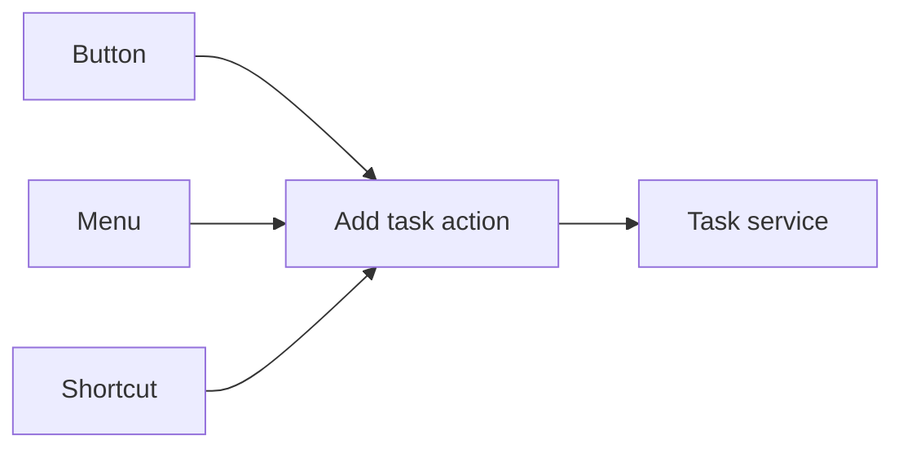

# Actions: give an operation a shared identity

An action is a named operation your application can execute, such as adding a task
or opening a settings page. It gives that operation a shared identity and execution
path instead of making each button or menu item own a separate implementation.

## Why use an action?

Imagine an Add task button, a menu item, and a keyboard shortcut. They can all refer
to the same action. The action's current availability and execution behavior stay
with that action; each interface decides how to present it.

Core owns registration and execution. React bindings (`<Action>`, `useAction`) read the
shared action state and connect it to controls. A shortcut or search surface still needs
its corresponding binding or optional plugin; defining an action alone does not create UI.

## Action or service method?

Use a service for reusable behavior and state, such as `add(title)` and a `store()` of
tasks. Use an action to expose an application operation that calls that behavior and
participates in the shared execution system: guards, pending, confirmation, feedback.
Not every internal function needs an action.

Presentation fields such as `enabled` and `visible` take a value or a function of the
input and services; functions re-run when a store they read changes. They help the
interface behave consistently but do not replace server authorization or validation of
untrusted input.

For navigation, an action with `href` describes a destination and the UI renders a real
link. Your framework router still owns the routes; an action does not create a page.

Continue with the [To-do tutorial](../../packages/core/docs/todo-tutorial.md),
[services](services.md), the [Actions guide](../../apps/docs/content/docs/concepts/actions.mdx)
or the [Core reference](../../packages/core/docs/reference.md).
